# 🚗 Automotive Aggregation & Vehicle Data Scraping 🔍

  

  
  
  
  
  
  
  

---

## 📌 Executive Summary & Overview

Welcome to the ultimate curated directory of **Automotive Aggregation, Vehicle Data Scraping, Dealership Inventory Feeds, VIN Decoding, and Automotive Market Intelligence Platforms**. 

Whether you are building an automated automotive arbitrage bot, mining dealership inventory changes, analyzing depreciation curves with OLAP engines, or integrating real-time vehicle identification number (VIN) decoders, this guide aggregates both industry-standard commercial SaaS ecosystems and top-performing open-source software libraries.

### 🎯 Key Target Use Cases
- 🏎️ **Dealership Inventory Scraping & Monitoring:** Track new, certified pre-owned (CPO), and used vehicle inventory across regional dealer networks.
- 📉 **Market Valuation & Depreciation Telemetry:** Ingest transaction values and auction results to train appraisal and resale pricing algorithms.
- 🔢 **VIN Decoding & Specification Enrichment:** Interrogate NHTSA vPIC and manufacturer databases for engine displacement, trim, plant of manufacture, and safety specs.
- 🔨 **Live Auction & Collector Bid Aggregation:** Crawl hammer prices, bid increments, and chassis registries across modern and vintage car auctions.

---

## 📑 Table of Contents
- [Sector Overview & Market Dynamics](#-sector-overview--market-dynamics)
- [SaaS & Hosted Automotive Platforms](#-saas--hosted-automotive-platforms)
- [Open-Source GitHub Projects](#-open-source-github-projects)
  - [Automotive Intelligence & VIN Decoders](#-automotive-intelligence--vin-decoders)
  - [High-Performance Crawlers & Scraping Engines](#-high-performance-crawlers--scraping-engines)
  - [Stealth Automation & Anti-Bot Bypassing](#-stealth-automation--anti-bot-bypassing)
  - [Data Warehousing, Analytics & Dashboarding](#-data-warehousing-analytics--dashboarding)
- [Star History](#-star-history)
- [How to Contribute](#-how-to-contribute)
- [Support](#-support)
- [Disclaimer](#-disclaimer)

---

## 📊 Sector Overview & Market Dynamics

The global online automotive and car-buying market is valued at approximately **$415 billion to $425 billion** and is projected to expand toward **$900+ billion** over the next decade at an 8% to 13% CAGR, with used-vehicle transactions accounting for nearly 70% of total digital volumes. 

Structurally, the sector exhibits **bifurcated dynamics**: while localized vehicle inventory and physical dealership operations remain **highly fragmented** across thousands of independent lots and franchise groups, the digital aggregation and transaction gateway layer is a **winner-take-most oligopoly** driven by formidable two-sided network effects, proprietary pricing moats, and heavy inventory logistics.

---

## 🏢 SaaS & Hosted Automotive Platforms

Below is an analytical overview of the premier commercial automotive aggregation portals, digital dealerships, and vehicle auction platforms, sorted in descending order by enterprise company scale (annual revenue / enterprise valuation).

| Platform | Category & Core Focus | Company Scale (Revenue / Valuation) | Starting Pricing Tier | Free Tier / Trial Limits |
| :--- | :--- | :--- | :--- | :--- |
| **[Carvana](https://carvana.com)** | Online Direct-to-Consumer Auto Retailer & Inventory Aggregator | **~$28.0B Revenue** (~$78B–$81B Market Cap) | Starting at vehicle purchase price (Fixed no-haggle pricing, 0 seller listing fee for trade-ins) | **7-day money-back trial guarantee** (valid up to 400 driving miles with full vehicle return refund) |
| **[AutoTrader](https://autotrader.com)** | Premier Marketplace, Dealership Inventory Syndication & Classifieds | **~$20.0B Revenue** (Parent Cox Enterprises; Cox Automotive Portfolio) | Starting at **~$450/month** (Entry dealer inventory package minimum 5 cars) or **$49 flat** for private party listings | **Free consumer buyer search & price alerts**; Dealerships have **0-day free trial** (custom forecourt demo only) |
| **[Kelley Blue Book (KBB)](https://kbb.com)** | Industry-Standard Valuation, ICO Dealer Network & Depreciation Analytics | **~$20.0B Revenue** (Parent Cox Enterprises; Cox Automotive Group) | Starting at **~$500/month** (Dealership Instant Cash Offer participating partner integration) | **100% Free forever for consumers** (unlimited vehicle valuation lookups & 7-day guaranteed cash offer generation) |
| **[Bring a Trailer (BaT)](https://bringatrailer.com)** | Premier Collector Car & Enthusiast Vehicle Auction Platform | **~$1.4B+ Annual GMV** (Hearst Autos Subsidiary; Hearst ~$12B Revenue) | **$99 flat upfront listing fee** for sellers (0% seller commission); 5% buyer fee (min $250, capped at $7,500) | **Free forever buyer account** (unlimited auction browsing, bid tracking, and historical sales chart lookups) |
| **[CarGurus](https://cargurus.com)** | Algorithmic Deal Rating, Inventory Marketplace & Price History Tracking | **~$907M Revenue** (~$3.67B Market Cap) | Starting at **~$1,200/month** (Standard dealer tier for low-inventory lots) | **Free forever consumer search & deal ratings**; Dealerships receive **0-day free trial** (requires quote-based demo) |
| **[Cars.com](https://cars.com)** | Digital Automotive Marketplace, Dealership Solutions & Lead Aggregator | **~$723M Revenue** (~$720M Market Cap; Cars Commerce) | Starting at **~$600/month** for full paid syndication or ~$175/lead bundled contract | **Free forever tier for independent dealerships** (**Cars.com Starter** includes full VDP listings capped at **10 shopper leads/month**) |
| **[Cars & Bids](https://carsandbids.com)** | Modern Enthusiast & Collector Vehicle Online Auction Platform | **~$200M+ Valuation** ($37M investment by The Chernin Group) | **$0 listing fee** for standard vehicle sellers (0% seller commission); 5% buyer fee (min $250, capped at $7,500) | **Free forever listing for sellers** ($0 upfront submission, unlimited browsing, past sale valuation archives) |
| **[TrueCar](https://truecar.com)** | Upfront Dealer Pricing Network, Price Curves & Lead Generation | **~$181M Revenue** (~$225M Market Cap) | Starting at **~$325 per vehicle sold** (Pay-Per-Sale performance model) or ~$800/month regional subscription | **Free forever consumer price-curve search**; Dealerships receive **0-day free trial** (performance pay-per-sale risk-free entry) |
| **[Hemmings](https://hemmings.com)** | Classic, Muscle & Vintage Automobile Marketplace & Auction Platform | **~$45M+ Est. Revenue** (American City Business Journals / Advance Pub.) | Starting at **$99.95 flat fee** (Auction listing) or **$149.95** (Traditional print + digital classified ad) | **Free forever buyer access** (unlimited search, historical price guide access, and make-offer tracking) |
| **[Edmunds](https://edmunds.com)** | True Market Value (TMV) Appraisals, Lease Calcs & Dealership Lead Network | **~$35M–$50M Est. Revenue** (Privately held automotive division) | Starting at **~$500/month** (Dealership regional inventory lead partnership contract) | **Free forever consumer research** (unlimited TMV appraisals, dealer quote matchers, and incentive calculators) |

---

## 💻 Open-Source GitHub Projects

Explore the top open-source projects for vehicle telemetry, VIN decoding, web scraping, browser automation, and data analytics. Sorted in descending order by **GitHub_Stars ⭐**.

### 🔍 Automotive Intelligence & VIN Decoders

| Project | Description | GitHub_Stars |
| :--- | :--- | :---: |
| **[commaai/openpilot](https://github.com/commaai/openpilot)** | Open-source advanced driver assistance system and vehicle CAN-bus interface compatible with 250+ car models. |  |
| **[cantools/cantools](https://github.com/cantools/cantools)** | Python tools and libraries for CAN bus DBC editing, message decoding, encoding, and diagnostic analysis. |  |
| **[brendan-w/python-OBD](https://github.com/brendan-w/python-OBD)** | Python module for handling live vehicle telemetry, sensor reading, and OBD-II PID communication via ELM327 adapters. |  |
| **[cardog-ai/corgi](https://github.com/cardog-ai/corgi)** | Open-source automotive vehicle specification extractor and comprehensive VIN decoder pipeline. |  |
| **[mickeyl/LTSupportAutomotive](https://github.com/mickeyl/LTSupportAutomotive)** | Complete iOS and macOS automotive framework for OBD-II vehicle telemetry parsing, trouble codes, and sensor diagnostics. |  |
| **[idlesign/vininfo](https://github.com/idlesign/vininfo)** | Python library for validating Vehicle Identification Numbers (VIN), extracting country, manufacturer, and model years. |  |

---

### 🕷️ High-Performance Crawlers & Scraping Engines

| Project | Description | GitHub_Stars |
| :--- | :--- | :---: |
| **[microsoft/playwright](https://github.com/microsoft/playwright)** | Reliable cross-browser end-to-end automation framework for Chromium, Firefox, and WebKit; ideal for scraping dynamic SPAs. |  |
| **[puppeteer/puppeteer](https://github.com/puppeteer/puppeteer)** | Node.js library providing a high-level API to control headless Chrome or Chromium for vehicle inventory extraction. |  |
| **[unclecode/crawl4ai](https://github.com/unclecode/crawl4ai)** | Open-source LLM-friendly web crawler that outputs cleaned markdown, structured JSON, and vehicle schema entities. |  |
| **[scrapy/scrapy](https://github.com/scrapy/scrapy)** | Fast high-level web crawling & scraping framework for Python, ideal for building scalable automotive marketplace spiders. |  |
| **[dgtlmoon/changedetection.io](https://github.com/dgtlmoon/changedetection.io)** | Self-hosted web page change detection and monitoring tool for tracking real-time vehicle price drops and restocks. |  |
| **[ScrapeGraphAI/Scrapegraph-ai](https://github.com/ScrapeGraphAI/Scrapegraph-ai)** | Python scraping pipeline utilizing LLMs and direct graph logic to extract dealer inventory without maintaining selectors. |  |
| **[apify/crawlee](https://github.com/apify/crawlee)** | Robust web scraping and browser automation library for Node.js featuring anti-blocking proxy management and session pools. |  |
| **[apify/crawlee-python](https://github.com/apify/crawlee-python)** | The Python counterpart to Crawlee, offering native async scraping, HTTP client rotation, and Playwright integration. |  |
| **[lorien/grab](https://github.com/lorien/grab)** | Python web scraping framework providing multi-threaded network tools, spider templates, and DOM parsing capabilities. |  |

---

### 🛡️ Stealth Automation & Anti-Bot Bypassing

| Project | Description | GitHub_Stars |
| :--- | :--- | :---: |
| **[SeleniumHQ/selenium](https://github.com/SeleniumHQ/selenium)** | The industry-standard browser automation framework supporting Python, Java, C#, and Ruby for web interaction. |  |
| **[daijro/camoufox](https://github.com/daijro/camoufox)** | Stealth Firefox-based browser configured specifically to resist advanced anti-bot fingerprinting and TLS detection. |  |
| **[ultrafunkamsterdam/nodriver](https://github.com/ultrafunkamsterdam/nodriver)** | Next-generation asynchronous web automation engine bypassing WebDriver detection by communicating directly via CDP. |  |
| **[wkeeling/selenium-wire](https://github.com/wkeeling/selenium-wire)** | Extends Selenium's Python bindings to give you access to underlying HTTP/HTTPS requests and vehicle API responses. |  |

---

### 📈 Data Warehousing, Analytics & Dashboarding

| Project | Description | GitHub_Stars |
| :--- | :--- | :---: |
| **[apache/superset](https://github.com/apache/superset)** | Modern enterprise data exploration and visualization platform for creating vehicle market pricing dashboards. |  |
| **[metabase/metabase](https://github.com/metabase/metabase)** | Easy-to-use business intelligence and analytics server for querying scraped dealership data and vehicle metrics. |  |
| **[duckdb/duckdb](https://github.com/duckdb/duckdb)** | In-process analytical SQL OLAP database designed for fast queries over massive Parquet vehicle price datasets. |  |
| **[sinaptik-ai/pandas-ai](https://github.com/sinaptik-ai/pandas-ai)** | Conversational data analysis tool integrating LLMs with Pandas dataframes to inspect automotive depreciation trends. |  |
| **[simonw/datasette](https://github.com/simonw/datasette)** | Tool for exploring and publishing SQLite databases, perfect for sharing scraped vehicle listing archives. |  |

---

## 📈 Star History

---

## 🤝 How to Contribute

Contributions are welcome! Please follow these simple steps:

1. 🍴 **Fork** this repository.
2. 🌿 **Create a branch**: `git checkout -b feature/new-vehicle-tool`.
3. 📝 **Add your tool**: Ensure you follow the table formatting, specify exact starting pricing, free tier limits, company valuation/revenue, or GitHub Stars_Count badges.
4. 🚀 **Submit a Pull Request** with a succinct description of the platform or library.

---

## 💖 Support

If you find this curated automotive data aggregation and scraping resource helpful, please consider supporting the project:

- ⭐ **Star this repository** on GitHub to improve its discovery.
- 🍴 **Fork and share** it with your engineering and automotive analytics team.
- ☕ **Buy me a coffee / Sponsor the project**: Support ongoing open-source curation via the [GitHub Sponsors Dashboard](https://github.com/sponsors/ishandutta2007).

---

## ⚠️ Disclaimer

- This repository is a community-curated educational index. Mention of commercial brands or repositories does not constitute endorsement.
- All web scraping, automated extraction, and API integrations should adhere to target domain Terms of Service, `robots.txt` directives, rate-limiting policies, and applicable data protection regulations.
- Always perform physical pre-purchase inspections and verify official state vehicle history reports before transacting.
